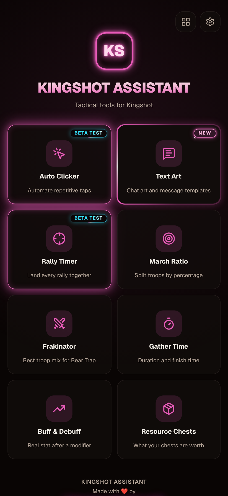
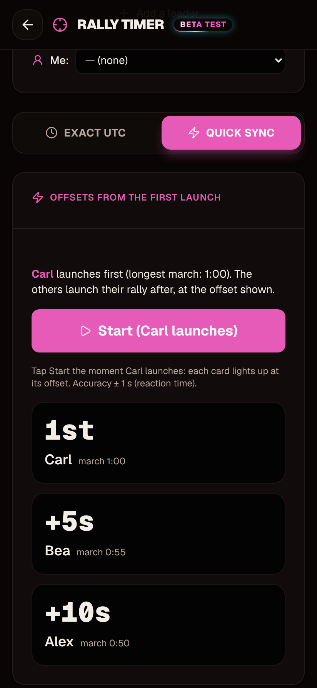
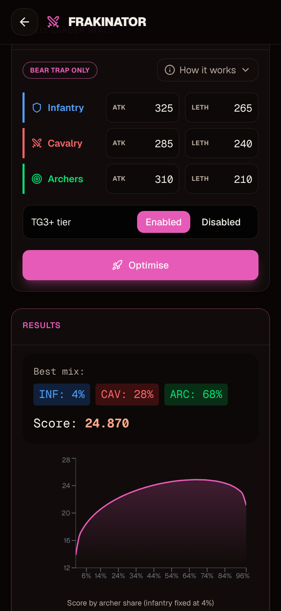
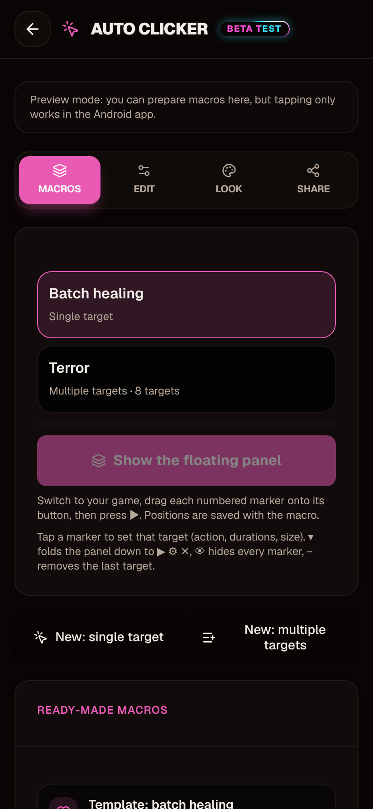
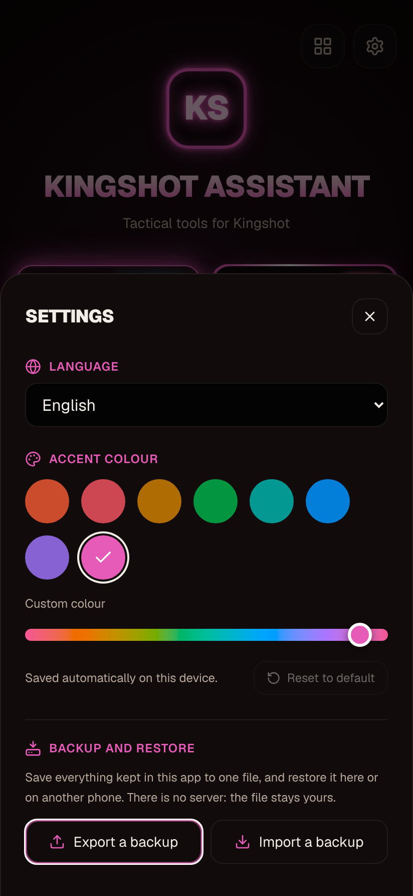

# KingShot Assistant

A pocket toolbox for Kingshot players: troop calculators, a rally timer that lands every march on the same second, and an auto clicker for the repetitive parts of the game.

It runs as an **Android app** (works offline) and as a **web app**, from one codebase.

<p align="center">
  
  
  
  
  
</p>

## Why it exists

It started as a handful of calculators for my alliance, to stop redoing the same sums in a spreadsheet before every event. Players kept asking for more, so it grew: first the troop maths, then rally coordination, which is the part of the game where a few seconds decide whether three rallies hit a castle together or one after the other.

Everything is built around how the game is actually played: you type the numbers the game shows you, and you get an answer you can act on or paste into alliance chat.

## What's inside

| Module | What it does |
|---|---|
| **Resource Chests** | Tells you what a stack of level 1–3 chests is worth, opened for a single resource or balanced across all four. |
| **Frakinator** | Finds the infantry / cavalry / archer mix that maximises a rally's damage score for a leader's attack and lethality. |
| **March Ratio** | Splits a troop count by percentage. The three numbers always add up to the total. |
| **Buff & Debuff** | Shows the real stat after a modifier. Stats multiply, so +10 % on a +200 % stat is +230 %, not +210 %. |
| **Gather Time** | Converts the gathering time shown in game into the time you'd get with more speed bonus, and when it finishes. |
| **Rally Timer** *(beta)* | Works out when each rally leader must launch so that everyone lands together. |
| **Auto Clicker** *(test, Android)* | Taps the screen for you: one point in a loop, or a saved sequence of points. |

### Rally Timer

Two ways to coordinate, sharing the same list of leaders and march times:

- **Targets** — the castle, one of the four turrets (north, south, east, west), or any name you type.
- **Exact UTC** — you set the arrival time; each leader gets a launch time (`arrival − march time`). The app does not trust the phone's clock: it measures its offset against an external time source, keeps the best of several samples, and shows the remaining uncertainty (`Synced ± 12 ms`).
- **Quick Sync** — no clock at all. The leader with the longest march launches first; everyone else launches a fixed number of seconds later. Good enough to ±1 s, and much easier to explain in chat.

Both tabs produce a short message ready to paste:

```
CASTLE HIT at 12:30:00 UTC
Launch your rally at:
12:27:55 Carl
12:28:50 Bea
12:29:15 Alex
```

On Android, a floating bubble keeps your own countdown on top of the game, with a beep and a vibration at T−3, T−2, T−1 and GO.

### Auto Clicker

A floating panel with numbered markers you drag onto the buttons you want pressed.

- **Single target** — one point, tapped at a fixed interval.
- **Multiple targets** — a sequence (tap, long press or swipe), each step with its own delay and repeat count, saved as a named macro.
- **Simultaneous** — every target pressed at the same moment, like several fingers.
- Everything is adjustable from the floating panel itself (⚙), which also folds down to a small floating button and shows the tap count and elapsed time while running.
- Macros can be copied as text and imported on another phone.
- Stops after a number of cycles, after a duration, or when you press stop. It also stops by itself when the screen turns off or the phone rotates.
- Ready-made macros: *batch healing* (one target every 20 ms) and *Terror* (a Terror rally every 2 minutes).

> [!WARNING]
> Most games forbid automation in their terms of service. The auto clicker is a general-purpose tool; using it in a game is at your own risk and can get an account sanctioned.

### Languages and appearance

English (default), French, German, Spanish, Portuguese (BR), Italian, Turkish and Russian. The accent colour is yours to pick. Both are saved on the device.

## Install

**Android** — download the latest APK from the [Releases](../../releases) page, open it and allow installation from that source. Android 7.0 or newer.

**Web** — the same app runs in a browser. The calculators and the rally timer work there; the floating bubble and the auto clicker need the Android app.

## How it's built

```
app/                     Next.js App Router: the shell (home tiles, module view)
components/              One file per module, plus settings
lib/                     Game logic, free of UI: unit-tested
  march-time.ts            rally maths and message building
  utc-clock.ts             clock synchronisation (NTP-style sampling)
  frakinator.ts, ratio.ts, modifiers.ts
  auto-clicker.ts          macro model and validation
  locales/                 one file per language, type-checked against a shared shape
android/                 Capacitor project
  app/src/main/java/…      native code (Java)
    RallyTimerService        countdown bubble + notification (foreground service)
    AutoClickService         gestures-only accessibility service, panel and markers
    *Plugin                  bridges between the web layer and the services
tests/                   node:test suites
```

- **One codebase, two targets.** The web app is a regular Next.js build. For Android, the same code is exported as static files and bundled into the APK with [Capacitor](https://capacitorjs.com), so the app works without a network.
- **Logic is separate from screens.** Everything that computes something lives in `lib/` as plain functions, which is what makes it testable.
- **Translations cannot drift.** Each language file must satisfy the same TypeScript interface, and a test checks every key in every language.
- **Native where the web cannot go.** Drawing over another app and injecting taps are done in Java, behind two small Capacitor plugins.

Stack: TypeScript, React 19, Next.js 16, Tailwind CSS 4, Capacitor 8, Java (Android SDK 36).

## Development

Requirements: Node 22, pnpm 10. For Android builds: JDK 21 and Android SDK platform 36.

```bash
pnpm install
pnpm dev            # web app on http://localhost:3000
pnpm typecheck
pnpm test
pnpm android:apk    # debug APK in android/app/build/outputs/apk/debug/
```

Every push runs type-checking, the tests, a dependency audit and both builds in GitHub Actions. Pushing a `release/*` branch builds the APK and publishes a GitHub release; see [`.github/workflows/release.yml`](.github/workflows/release.yml) for the signing secrets it expects.

## Security and privacy

- **No account, no tracking in the app, no data leaves the phone.** Settings, leaders and macros are stored locally. The Android app's only network request is the clock synchronisation.
- **The auto clicker cannot read your screen.** Its accessibility service asks for gesture dispatch only: no screen events, no window content.
- **Signing keys are not in the repository.** Release builds are signed in CI from secrets and shrunk with R8.

Details, permissions and how to report a problem: [SECURITY.md](SECURITY.md).

## Status

The calculators are stable. Rally Timer is in beta and Auto Clicker is in test: both rely on Android features that behave differently from one phone brand to another, so feedback from real devices is what moves them forward. Known gaps are tracked in the [release notes](docs/release-notes).

## Disclaimer

This is a fan-made tool. It is not affiliated with, endorsed by, or connected to the publisher of Kingshot. Game names and assets belong to their respective owners.

---

### En français

KingShot Assistant regroupe des outils pour les joueurs de Kingshot : calculateurs de troupes et de ressources, un minuteur de rallies qui fait atterrir toutes les marches à la même seconde, et un auto clicker pour les actions répétitives. L'application existe en version Android (utilisable hors ligne) et en version web, à partir du même code. Elle est disponible en huit langues, dont le français. L'APK se télécharge depuis la page [Releases](../../releases).
